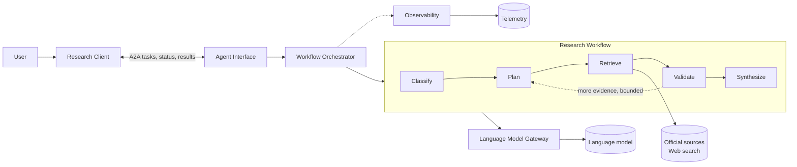

# Spain Housing Access — A2A Research Agent

An Agent-to-Agent (A2A) research agent that explains housing access in Spain
using current, verifiable evidence: prices, rents, wages, supply, legislation,
public policy, tourism, short-term rentals, and social movements. A Vue.js web
client talks to the agent over the A2A protocol.

Research can cover Spain as a whole, an autonomous community, a province, a
municipality, or a neighborhood when reliable data exists. Answers are neutral,
cited, and state their limitations. The agent does not give personalized legal
or financial advice, valuations, or forecasts. See [AGENTS.md](AGENTS.md) for
the full scope, sourcing, and response rules.

> **Status:** early scaffolding. The architecture is defined; the workflow,
> tools, A2A server, and web client are not implemented yet.

## Architecture

The diagrams are the primary design reference. Open them in draw.io or the
VS Code Draw.io extension.

| Diagram | Content |
| --- | --- |
| [use-cases.drawio](docs/architecture/use-cases.drawio) | Actors, use cases, and external providers |
| [c4-logical.drawio](docs/architecture/c4-logical.drawio) | C1 context, C2 containers, C3 agent components (technology-free) |
| [physical-architecture.drawio](docs/architecture/physical-architecture.drawio) | Local deployment and logical-to-physical mapping |

### Use cases

- **Housing information user:** submits a research request, receives progress
  or errors, and reviews the answer with citations and limitations.
- **System operator:** configures providers and limits, and monitors execution
  and answer quality.

### Logical view



Supporting components: **Research State** (shared workflow state) and
**Configuration** (providers, timeouts, retry and research-depth limits).

### Physical view (local)

| Logical component | Implementation |
| --- | --- |
| Research Client | Vue.js SPA with an A2A JavaScript client, served by Vite (`:5173`) |
| Agent Interface | `a2a-sdk` Starlette app on Uvicorn (`:8000`), agent card at `/.well-known/agent-card.json`, `InMemoryTaskStore` |
| Workflow bridge | `a2a-sdk` `AgentExecutor` wrapping the compiled graph; A2A `contextId` → LangGraph `thread_id` |
| Workflow Orchestrator and steps | LangGraph `StateGraph` with classify, plan, research, validate, and synthesize nodes |
| Research State | Typed graph state + LangGraph `InMemorySaver` (short-term memory) |
| Language Model Service | LM Studio, OpenAI-compatible API (`:1234/v1`) |
| Web Search Service | Google Programmable Search (Custom Search JSON API) |
| Telemetry Service | Langfuse, self-hosted with Docker Compose (`:3000`) |
| Configuration | Environment variables from a git-ignored `.env` |

All state is in memory and is lost on restart. SQLite for long-term memory is
planned but not in scope yet. API keys live only on the agent server; the
browser talks only to the A2A endpoint.

### Project structure

```text
src/
├── a2a_client/                 # Python A2A client
└── housing_access_agent/
    ├── a2a/                    # Agent card and AgentExecutor
    ├── domain/                 # Research and evidence types
    ├── tools/                  # Google Search and official-source adapters
    ├── workflow/               # classifier, planner, researcher, validator, synthesizer
    ├── config.py               # Environment-based configuration
    ├── graph.py                # LangGraph composition root
    ├── observability.py        # Logging, tracing, quality signals
    ├── prompts.py              # Agent prompts
    ├── server.py               # A2A server entry point
    └── state.py                # Workflow state
tests/
├── integration/a2a/            # A2A protocol tests
└── unit/                       # workflow/ and tools/ tests
docs/architecture/              # draw.io diagrams
```

The Vue.js web client is not in the repository yet.

## Prerequisites

- Python 3.11+
- Node.js (for the Vue.js client)
- LM Studio with a model that supports tool calling or structured output
- Docker (for self-hosted Langfuse)
- Google Programmable Search API key and search engine ID. Check that the
  Custom Search JSON API is still available to new projects before relying on it.

## Configuration

Copy `.env.example` to `.env` and fill in the values. Never commit `.env`.

| Variable | Purpose |
| --- | --- |
| `MODEL_NAME`, `MODEL_API_KEY` | Language model and its key |
| `GOOGLE_SEARCH_API_KEY`, `GOOGLE_SEARCH_ENGINE_ID` | Google Programmable Search |
| `A2A_HOST`, `A2A_PORT`, `A2A_AGENT_URL` | Agent bind address and public A2A URL |

The model base URL (LM Studio), Langfuse keys, and research limits still need
to be added to `.env.example`.

## Development setup

```bash
python -m venv .venv && source .venv/bin/activate
pip install -e ".[dev]"
pytest
```

Run commands for the agent server and web client will be documented once they
exist.

## Example requests

- What factors are affecting access to rental housing in Madrid?
- Summarize recent changes in residential rental prices in Barcelona.
- Compare housing-access challenges in Valencia and Málaga.
- What public housing measures have recently been announced in Spain?
- What evidence links short-term rentals to housing supply in a municipality?

## Response guidelines

Answers should:

- Prefer official and primary sources (INE, MIVAU, BOE, Banco de España,
  registries, regional and municipal authorities).
- Distinguish facts, estimates, opinions, and causal hypotheses.
- Separate publication dates from event dates for time-sensitive claims.
- Attribute stakeholder claims and differing estimates.
- Cite every supporting source and state uncertainty or missing verification.
- Answer in the user's language, defaulting to Spanish.

## Contributing

1. Keep each change focused, and keep the diagrams in sync with design changes.
2. Add or update tests for new or modified behavior.
3. Run the tests and any lint or build checks.
4. Update this README when setup, configuration, commands, or behavior change.
5. Never commit credentials or machine-specific configuration.

## License

[MIT](LICENSE) © 2026 Ricardo Trujillo Rodríguez
